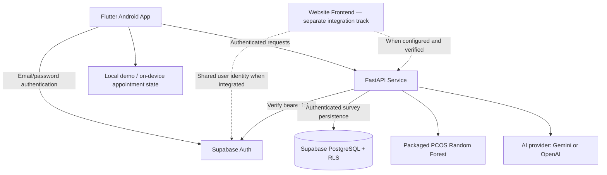

<div align="center">

# 🌸 AuraCare — Your Body. Your Space.

### A thoughtful, AI-assisted women's reproductive health companion

**Track your rhythm. Understand your health. Prepare for better conversations.**

[](https://flutter.dev/)
[](https://dart.dev/)
[](https://fastapi.tiangolo.com/)
[](https://supabase.com/)
[](auracare_pcos/)
[](#-implementation-status)

</div>

---

## 📌 The Problem & Why It Matters

Reproductive health journeys are rarely linear. Menstrual patterns, symptoms, mood, fertility questions and life-stage changes can be difficult to understand—especially when important details are scattered across calendars, notes and multiple apps.

AuraCare aims to make this information easier to **record, revisit and discuss**, without treating incomplete records as certainty or replacing professional medical guidance.

**Our approach:** one gentle, approachable space for cycle tracking, wellbeing, education, experimental PCOS assessment and preparation for healthcare conversations.

## ✨ What AuraCare Offers

| Experience | What it does | Current scope |
| --- | --- | --- |
| 🩷 **Cycle & flow tracking** | Log bleeding days and light, moderate or heavy flow; review your timeline and historical cycle summaries. | Implemented in Flutter |
| 🌿 **Cycle-phase visualization** | Optional estimates of cycle phases and upcoming periods, based on recorded starts and eligibility rules. | Experimental calendar estimates; **not verified fertility predictions** |
| 😊 **Wellbeing check-ins** | Record moods and observations alongside cycle entries, with calendar indicators. | Flutter prototype |
| 📓 **Private journal** | Write and revisit personal reflections and notes. | App-level flows; cloud health persistence gated |
| 🧬 **PCOS questionnaire** | Submit a reviewed set of inputs to a trained Random Forest model, or use a separate four-question symptom-count survey. | Authenticated API routes; **non-diagnostic experimental outputs** |
| 📚 **Learn** | Explore reproductive-health topics, from menstrual health to pregnancy, postpartum, menopause and later life. | Structured, source-linked Flutter articles; clinical editorial review pending |
| 📈 **Insights** | View descriptive trends derived from recorded entries and their coverage. | Descriptive only; not a medical diagnosis |
| 🩺 **Doctor & appointment preparation** | Organize appointments, questions and selected notes for a healthcare conversation. | Device-local organizer; **not real provider booking** |
| 💬 **AI assistant** | Ask general health questions with explicit confirmation before each AI-processed message. | Authenticated `/chat` endpoint when server-side AI provider is configured |

Some additional experimental UI modules may be present in the Flutter source. Their status should be verified in their corresponding handoff documents before being described as deployed capabilities.

---

## 🧠 PCOS: Machine Learning, Not a Diagnosis

AuraCare contains **two distinct assessment paths**:

1. **Experimental trained-model questionnaire:** `POST /pcos/model-assessment` uses a packaged, calibrated Random Forest pipeline with validated input handling and explicit abstention states. The returned model score reflects a research-model association, **not an individual's probability of PCOS**.
2. **Four-question symptom summary:** `POST /predict-pcos` counts reported symptoms. It is **not a model-derived clinical risk percentage**, a diagnosis or a screening threshold.

Unknown responses remain unknown. Requests require a valid authenticated user token; demo flows are clearly separated from live inference. See [PCOS model integration](docs/PCOS_MODEL_INTEGRATION.md), [Flutter PCOS integration](docs/FLUTTER_PCOS_INTEGRATION.md) and the [PCOS model workspace](auracare_pcos/).

> **Medical disclaimer:** AuraCare is a development prototype for personal recording, education and experimental research. It does not diagnose PCOS, confirm ovulation, predict contraception-safe days, prescribe treatment or replace a qualified healthcare professional. Do not enter real sensitive health information until the applicable deployment, migration, access-control and privacy checks are complete.

---

## 🏗️ System Architecture



**Important architecture boundaries:** The website must reuse the same backend and Supabase project rather than creating a second database. Some mobile health-record operations are currently local/session-only; authenticated remote persistence is controlled by a deployment gate that is **off by default**. The diagram indicates intended integration boundaries, not proof that all cross-device synchronization is deployed.

For implementation details, see [Architecture](docs/ARCHITECTURE.md), [API specification](docs/API_SPECIFICATION.md), [Networking](docs/FLUTTER_NETWORKING.md) and [Database validation](docs/HEALTH_MIGRATION_VALIDATION.md).

## 🛠️ Technology Stack

| Layer | Technology |
| --- | --- |
| Mobile application | **Flutter**, **Dart** |
| API/backend | **Python**, **FastAPI**, **Pydantic** |
| Authentication and relational data | **Supabase Auth**, **PostgreSQL**, proposed/implemented **RLS policies** (deployment must be verified) |
| PCOS inference | **scikit-learn Random Forest** with fitted preprocessing/calibration |
| AI chat | Server-side **Gemini** or **OpenAI** integration, subject to configuration |
| Website | Website integration is a separate frontend workstream; verify its current branch and deployment before describing it as shipped |
| Tests | Flutter widget/unit tests, Python API/security/model tests |

---

## 📂 Repository Structure

```text
AuraCare/
├── Auracare_mobile_app/
│   └── auracare_mobile_app/
│       ├── lib/
│       │   ├── app/                 # App entry and navigation
│       │   ├── core/                # Branding, calendar, shared 2D artwork/widgets
│       │   ├── data/                # Repositories, auth/API clients
│       │   └── features/            # Home, cycle, timeline, PCOS, Learn,
│       │                            # wellbeing, journal, doctor, insights ...
│       ├── test/                    # Flutter tests
│       ├── android/                 # Android project
│       └── pubspec.yaml
├── service/
│   ├── main.py                      # FastAPI routes/auth/chat
│   ├── pcos_model.py                # Trained-model serving
│   ├── tests/                       # API/security tests
│   └── requirements.txt
├── auracare_pcos/
│   ├── models/                      # Delivered model package
│   ├── train.py                     # Training workflow
│   ├── predict.py                   # Model inference utilities
│   ├── quiz_contract.json          # Input contract
│   └── README.md
├── supabase/
│   ├── migrations/                  # Database schema/migration files
│   └── tests/
├── docs/                           # Specifications and implementation handoffs
├── .env.example                     # Example server configuration (no real keys)
├── requirements.txt
└── README.md
```

> The structure above reflects the tracked **`main`** branch. Other branches may contain website work or additional changes not yet merged into `main`.

---

## ⚡ Quick Start

### 1. Clone the repository

```powershell
git clone https://github.com/soumyadesh0-ship-it/AuraCare.git
cd AuraCare
```

### 2. Configure and run the FastAPI backend

Use Python with a virtual environment. **The server requires the team's existing Supabase project URL and public anon/publishable key; never commit credentials.**

```powershell
python -m venv .venv
.\.venv\Scripts\Activate.ps1
pip install -r service/requirements.txt
Copy-Item .env.example .env
# Edit .env locally with your own project settings.
python -m uvicorn service.main:app --host 127.0.0.1 --port 8000
```

API documentation: **http://127.0.0.1:8000/docs**

Relevant endpoints:

| Method | Endpoint | Purpose |
| --- | --- | --- |
| `POST` | `/pcos/model-assessment` | Experimental Random Forest questionnaire |
| `POST` | `/predict-pcos` | Four-question symptom-count summary |
| `POST` | `/chat` | AI assistant, with explicit per-message processing confirmation |

Protected endpoints require a valid **Supabase user access token**; the public anon key is **not** a user bearer token.

### 3. Run the Flutter Android application

```powershell
cd Auracare_mobile_app\auracare_mobile_app
flutter pub get
flutter devices
```

Supply the public Supabase client settings and the reachable API URL using Dart defines. For a standard Android emulator:

```powershell
flutter run `
  --dart-define=SUPABASE_URL=https://YOUR_PROJECT.supabase.co `
  --dart-define=SUPABASE_ANON_KEY=YOUR_PUBLIC_ANON_KEY `
  --dart-define=AURACARE_API_BASE_URL=http://10.0.2.2:8000
```

For a **USB-connected physical Android device**, run `adb reverse tcp:8000 tcp:8000` and set the API URL to `http://127.0.0.1:8000` in a **debug** build. For a production/release configuration, use HTTPS. See the [mobile README](Auracare_mobile_app/auracare_mobile_app/README.md) and [networking guide](docs/FLUTTER_NETWORKING.md) for the full setup and configuration safeguards.

### 4. Run verification

From the Flutter app folder:

```powershell
flutter analyze
flutter test --concurrency=1
```

From the repository root with the backend environment activated:

```powershell
pip install -r service/requirements-test.txt
python -m pytest service/tests
```

These commands describe **how to run tests**; they do not assert that the tests have passed on your machine or that live production services are verified.

---

## 🔐 Privacy & Data Handling

- **Authentication:** Flutter email/password flows use Supabase sessions. OAuth availability depends on actual provider setup.
- **Demo mode:** Clearly labeled synthetic records stay separate from authenticated accounts.
- **Sensitive records:** Authenticated cloud health persistence is behind a deployment gate **disabled by default**, pending migration, RLS and privacy validation.
- **PCOS:** Model-assessment requests are authenticated; experimental output must not be represented as a clinical probability.
- **AI chat:** User confirmation is required **per message**; chat does not automatically attach journal or health records.
- **Appointments:** The organizer uses app-private Android storage and does **not** book appointments with clinicians.
- **Security status:** Code-level controls and tests are not proof of a production security audit, regulatory certification or deployed database enforcement.

Read [Security & Privacy](docs/SECURITY_AND_PRIVACY.md), [Authentication](docs/FLUTTER_AUTHENTICATION.md), and [Health migration readiness](docs/HEALTH_MIGRATION_VALIDATION.md).

## 🚧 Implementation Status & Roadmap

| Area | Status / next validation |
| --- | --- |
| Flutter UI and core tracking flows | Implemented prototype; device behavior varies by build/configuration |
| Supabase login | Implemented in Flutter; live email/device integration requires environment verification |
| PCOS experimental model | API integration implemented; validate artifact/runtime and interpretation before external use |
| AI assistant | Protected API route implemented; requires server-side provider credentials and live testing |
| Learn articles | Source-linked content; formal clinical editorial review pending |
| Shared cloud health history | **Not production-ready** until migration history, RLS and deployment gate are verified |
| Website/mobile synchronized experience | Verify website branch, deployment and feature-by-feature API integration |
| Provider bookings and clinical deployment | Not claimed |

## 📖 Documentation

- [Product overview](docs/PRODUCT_OVERVIEW.md) · [Features](docs/FEATURES.md) · [User flows](docs/USER_FLOWS.md)
- [Design system](docs/DESIGN_SYSTEM.md) · [Mobile UI handoff](docs/MOBILE_UI_HANDOFF.md) · [Latest UI refinements](docs/AURACARE_REFINEMENT.md)
- [API contracts](docs/API_SPECIFICATION.md) · [Backend](docs/BACKEND.md) · [Flutter networking](docs/FLUTTER_NETWORKING.md)
- [PCOS research workflow](auracare_pcos/README.md) · [Model integration](docs/PCOS_MODEL_INTEGRATION.md)
- [Phase 3: cycle estimates, doctor and Learn](docs/AURACARE_PHASE3.md)
- [Authentication](docs/FLUTTER_AUTHENTICATION.md) · [Security & privacy](docs/SECURITY_AND_PRIVACY.md)
- [Migration readiness](docs/HEALTH_MIGRATION_VALIDATION.md) · [Testing](docs/TESTING.md)

## 👥 Collaboration

This is a shared project. Develop UI, backend and documentation changes on reviewable branches, preserve teammates' work, and merge via pull requests after checking tests and integration behavior. Do not commit generated `build/` files, model caches or credentials.

## 📜 License

No license file was found in the inspected root of `main`. **Do not assume an MIT or other open-source license** unless the maintainers add one.

---

<div align="center">

**AuraCare — Your Body. Your Space.** 🌸

*Designed to make personal health information easier to understand, record and discuss.*

</div>
